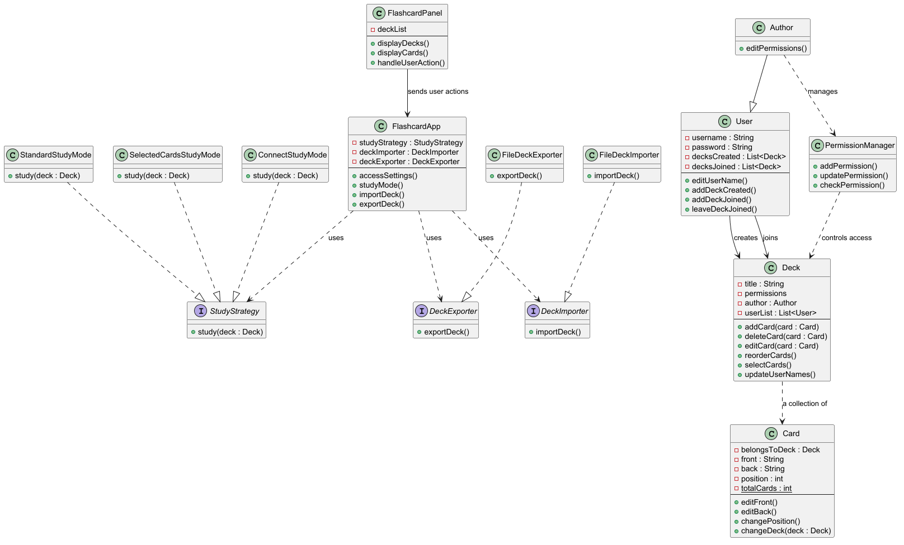

# Team CYEK Project

# Project Name - Flashcard? 
## Team Information
### Team Members
- Charles Shen
- Yara Megahed
- Ellie Mamykin
- Kobi Liu

### Team Number
[TUT0202] Group 02 - BA2200

---
## Project Description
This is a flashcard application that allows multiple users to create and edit the same flashcards and 
flashcard decks in real time. An author can create a flashcard deck and create access permissions that 
other users can use for access to edit the deck's flashcards. 
The flashcard application will allow importing of exported decks from other flashcard applications (ie 
namely Anki) by accessing their text files through API and using them to generate a new deck in our 
flashcard application's style. Our application also includes a study mode so that users can track their 
progress on each flashcard or deck.

Optional TBD: Create a chatbot with API that can generate answers about the current flashcard if 
prompted by the user.

### Domain
[Education, Organization, Collaboration]

---

## User Stories
### User Story 1 !
As a user, I want to create an account and log in/log out as needed, so that my card decks, my learning progress, and 
any progress of creating my own deck are stored.
### User Story 2
As a user, I want to edit and/or be able to delete my account, so I can update my account info and settings as needed, 
as well as deleting it when I don't want to use the app anymore.
### User Story 3 !
As a learner, I want to study a deck of cards through a clean, interactive interface, so I can test my memorization and
understanding in a smooth, low-stake way.
### User Story 3.1a !
As a learner, I want to see a progress bar when I am studying, so I can see how many cards I have gone through.
### User Story *3.1b
As a learner, I want to see an overview or a cross-session stats, so I can see how I have improved over sessions.
### User Story 3.2 !
As a learner, I want to save the cards I didn't get when I am studying, so I can go back and try them again later.
### User Story 3.3
As a learner, I want to shuffle the cards in a deck when I am studying, so I can study cards in any order/orderless.
### User Story 4 !
As a creator, I want to create new decks using a blank deck/template deck, so I can build custom decks of my own.
### User Story 5
As a creator, I want to preview a deck I have created, so I can make sure it satisfies my requirement and/or provides
good experience for whoever will be using it, too.
### User Story 6 !
As a creator, I want to save the cards and decks I have created, so I can use them later.
### User Story 7
As a user, I want to organize my decks into categories (e.g. by topic), so I can easily find and manage decks 
for different subjects.
### User Story *1
As a creator, I want to manage the access/permissions to a deck I have created, so that I have control over who can 
use it and/ or edit it collaboratively with me. 
### User Story *2
As a creator, I want to export a deck I have created in (certain) formats/share it via a link, so I can use it 
in other places on my computer/share it with whom I want.
### User Story *3
As a collaborator, I want to join other people's deck creation through their invitation, so I can collaborate with them.
### User Story *4
As a user, I want to import existing decks to add them to my decks/add existing decks to my decks via a link, so I can 
study decks I have on my computer/so I can study decks that other people have created.

---

## Use Cases
### Use Case 1
### Use Case 2
### Use Case 3
(Add additional use cases as needed.)

---

## Minimal Viable Product (MVP)
| Team Member | MVP Use Case |
|-------------|--------------|
| Name | Use Case |
| Name | Use Case |
| Name | Use Case |

---

## Entities
### Entity 1
### Entity 2
(Add additional entities as needed.)

---

## API Usage
**API Name:**
**Documentation:** [Link]
**How it is used in the program:**

---

## Design Diagrams

### UML Class Diagram

### Sequence Diagrams

---

## How to Run
[Instructions for running the program.]

---

## Notes
[Any additional project information.]

Use Figma first to discuss and design GUI before finalization and implementation

Create 3 databases as CSVs initially:
- User Database
- Card Database
- Deck Database
