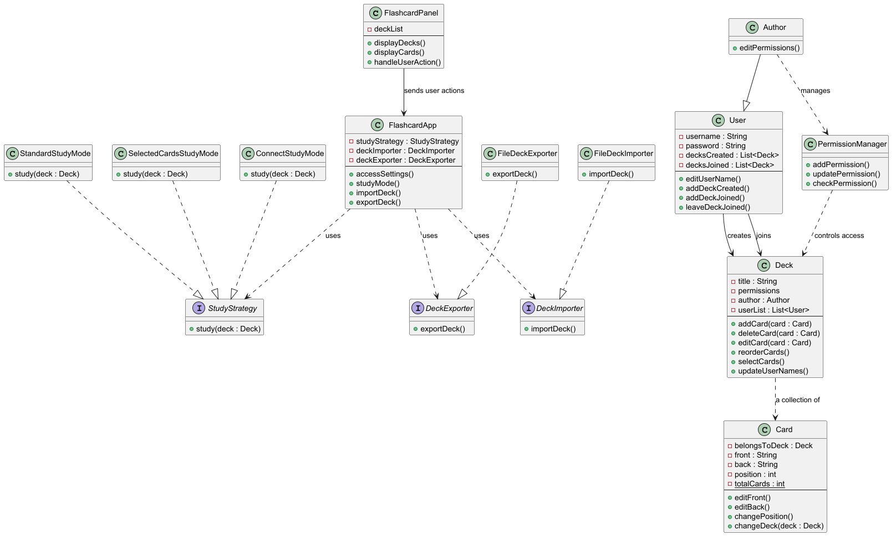

# Team CYEK Project

# Project Name - Flashcard? 
## Team Information
### Team Members
- Charles Shen
- Yara Megahed
- Ellie Mamykin
- Kobi Liu

### Team Number
[TUT0202] Group 02 - BA2200

---
## Project Description
This is a flashcard application that allows multiple users to create and edit the same flashcards and 
flashcard decks in real time. An author can create a flashcard deck and create access permissions that 
other users can use for access to edit the deck's flashcards. 
The flashcard application will allow importing of exported decks from other flashcard applications (ie 
namely Anki) by accessing their text files through API and using them to generate a new deck in our 
flashcard application's style. Our application also includes a study mode so that users can track their 
progress on each flashcard or deck.

Optional TBD: Create a chatbot with API that can generate answers about the current flashcard if 
prompted by the user.

### Domain
[Education, Organization, Collaboration]

---

## User Stories
### User Story 1
### User Story 2
### User Story 3
(Add additional user stories as needed.)

---

## Use Cases
### Use Case 1
### Use Case 2
### Use Case 3
(Add additional use cases as needed.)

---

## Minimal Viable Product (MVP)
| Team Member | MVP Use Case |
|-------------|--------------|
| Name | Use Case |
| Name | Use Case |
| Name | Use Case |

---

## Entities
### Entity 1
### Entity 2
(Add additional entities as needed.)

---

## API Usage
**API Name:**
**Documentation:** [Link]
**How it is used in the program:**

---

## Design Diagrams

### UML Class Diagram

### Sequence Diagrams

---

## How to Run
[Instructions for running the program.]

---

## Notes
[Any additional project information.]

Use Figma first to discuss and design GUI before finalization and implementation

Create 3 databases as CSVs initially:
- User Database
- Card Database
- Deck Database
